<div align="center">

# HisabMate

### Personal Finance. Multiple Currencies. One Private Workspace.

**An offline-first Android finance manager built with Kotlin, Jetpack Compose and Room.**

<p>
  <a href="https://github.com/CodeByArnob/HisabMate/releases/download/v1.0.6/HisabMate-v1.0.6-release.apk">
    
  </a>
  <a href="https://github.com/CodeByArnob/HisabMate/releases/tag/v1.0.6">
    
  </a>
  <a href="https://codebyarnob.github.io/HisabMate/">
    
  </a>
</p>

<p>
  
  
  
  
  <a href="https://github.com/CodeByArnob/HisabMate/actions/workflows/android-ci.yml">
    
  </a>
  <a href="LICENSE">
    
  </a>
</p>

<br>


</div>

---

## Overview

HisabMate is an **offline-first personal finance application for Android**. It brings everyday money management into one place: bank accounts, cards, mobile wallets, cash, foreign currencies, budgets, savings goals, recurring bills and debt records.

The app is designed around three principles:

- **Local-first:** financial records are stored on the device using Room and SQLite.
- **Currency-aware:** transactions retain their original currency, with saved exchange-rate snapshots for reporting and conversion.
- **Practical portability:** users can export and restore their data, and generate PDF and CSV reports.

| Project detail | Value |
|---|---|
| Application ID | `com.aistudio.hisabmate.fntkbd` |
| Current release | **v1.0.6** · versionCode 7 |
| Minimum Android | Android 7.0 · API 24 |
| Target Android | API 36 |
| Database | Room · SQLite schema v7 |
| License | MIT |

## Download

<div align="center">

### HisabMate v1.0.6

**The latest published Android release**

[**Download the APK**](https://github.com/CodeByArnob/HisabMate/releases/download/v1.0.6/HisabMate-v1.0.6-release.apk) · [Release page and other assets](https://github.com/CodeByArnob/HisabMate/releases/tag/v1.0.6)

</div>

| File | Description |
|---|---|
| `HisabMate-v1.0.6-release.apk` | Android installer |
| `HisabMate-v1.0.6-release.aab` | Android App Bundle |
| `SHA256SUMS.txt` | SHA-256 checksums |
| `SIGNING-CERTIFICATE.txt` | APK signing certificate details |

> [!IMPORTANT]
> **Signing and installation compatibility:** v1.0.6 was signed with a temporary CI-generated key because the original production keystore was not available. That temporary key was not retained. Android will not install this APK as an in-place update over an installation signed with a different key. If you are moving from an older installation, export a JSON backup first, uninstall the old app, install v1.0.6, then restore your backup. Uninstalling clears the app's local data.
>
> A future APK signed with a different key will also require a backup and reinstall. A persistent signing key must be configured before the next release to establish a stable update path.

---

## Features

### Accounts and wallets
- Track bank accounts, cash, credit/debit cards and mobile financial service wallets.
- Organize wallets such as bKash, Nagad and Rocket alongside international accounts.
- Record transfers between accounts, including cross-currency transfers.

### Multi-currency support
- Built-in support for **14 currencies**.
- Store each account and transaction in its original currency.
- Configure and manage exchange rates offline.
- Use saved exchange-rate snapshots for historical transaction conversion and reporting.
- Support South Asian and international number grouping.

### Budgets and savings
- Create daily, weekly, monthly, yearly and custom-period budgets.
- Monitor spending against budget limits with local alerts.
- Track savings goals, target amounts, deadlines and contributions.

### Bills and debt tracking
- Record recurring payments and due dates.
- Track money lent and money borrowed separately.
- Record partial repayments and outstanding balances.
- Schedule local reminders for upcoming obligations.

### Reports and data portability
- Receive an instant local confirmation after each successfully saved expense, income or transfer, including the transaction name, amount, category and account.
- Review transaction receipts in the in-app Notification Center; Android 13+ asks for notification permission before the first receipt is posted.
- Generate a **single-page A4 PDF financial statement**.
- Export transaction data to CSV.
- Create and restore JSON backups.
- Share generated documents through Android's FileProvider.

---

## Screenshots

The screenshots below are grouped by workflow. Expand a section to view its screens.

<details>
<summary><strong>Dashboard and app experience</strong></summary>
<p align="center">
  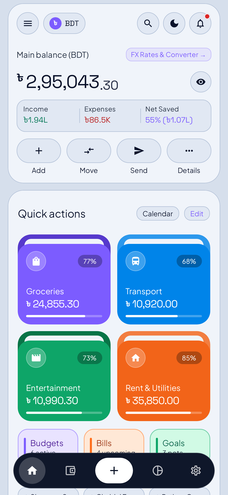
  <br><em>Dashboard — Light theme</em>
</p>
<p align="center">
  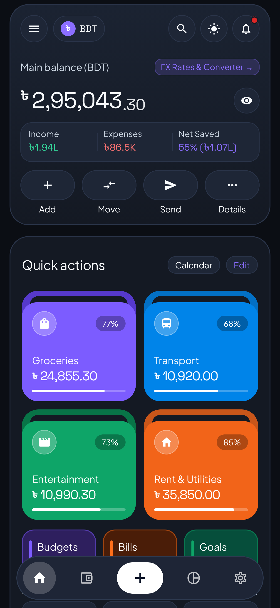
  <br><em>Dashboard — Dark theme</em>
</p>
<p align="center">
  
  <br><em>App walkthrough</em>
</p>
</details>

<details>
<summary><strong>Accounts, wallets and currencies</strong></summary>
<p align="center">
  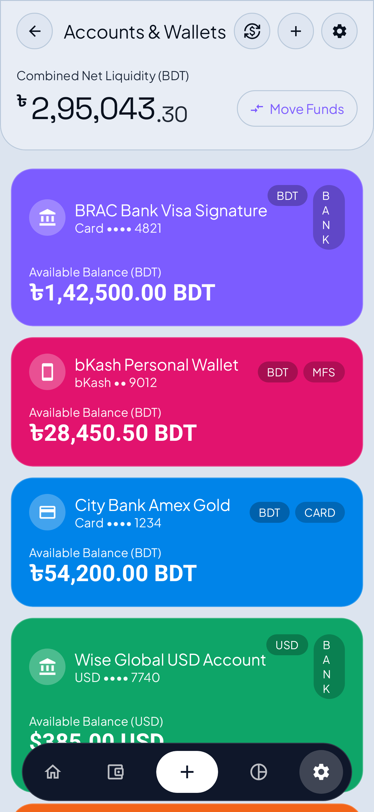
  <br><em>Accounts and wallets</em>
</p>
<p align="center">
  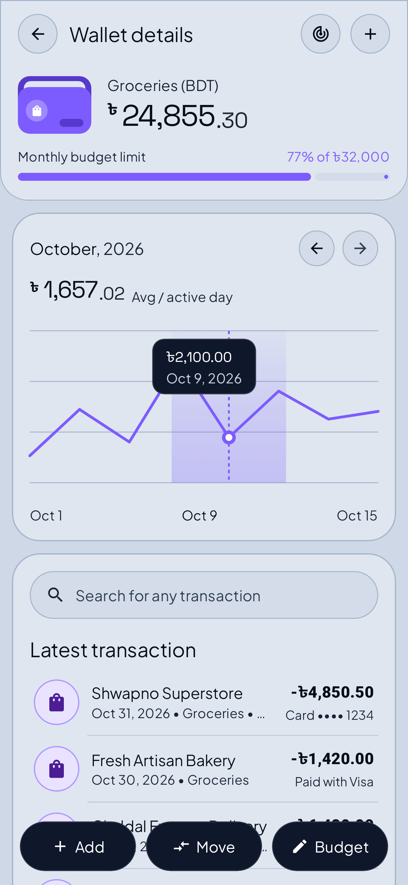
  <br><em>Wallet details and analytics</em>
</p>
<p align="center">
  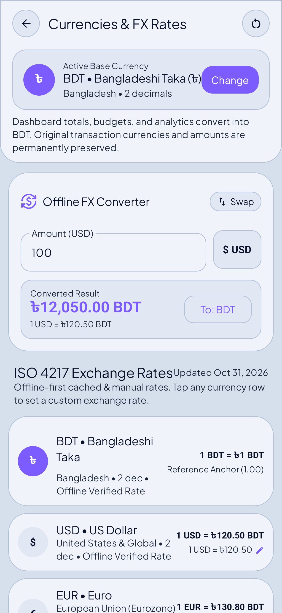
  <br><em>Multi-currency and offline FX</em>
</p>
</details>

<details>
<summary><strong>Budgets, reports and savings</strong></summary>
<p align="center">
  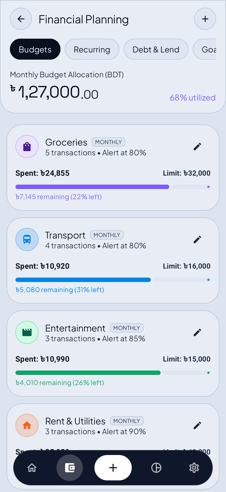
  <br><em>Budget management</em>
</p>
<p align="center">
  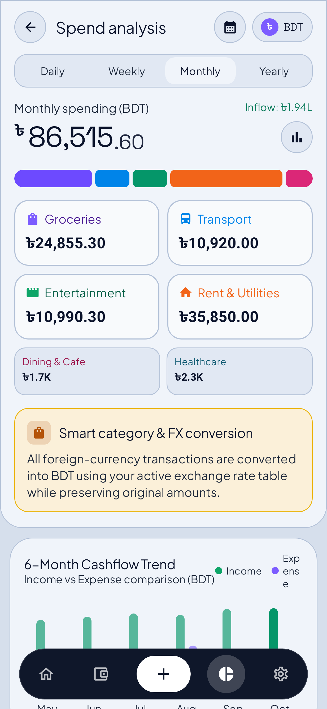
  <br><em>Financial reports</em>
</p>
<p align="center">
  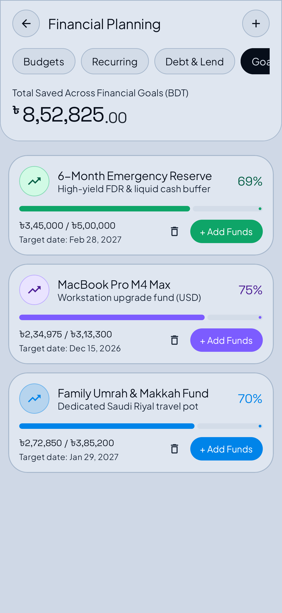
  <br><em>Savings goals</em>
</p>
</details>

<details>
<summary><strong>Debts, reminders and settings</strong></summary>
<p align="center">
  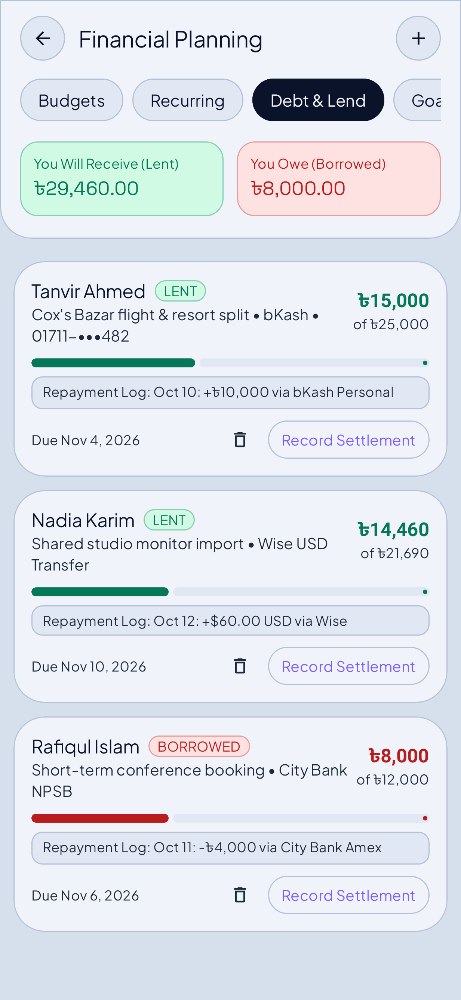
  <br><em>Debt and loan tracking</em>
</p>
<p align="center">
  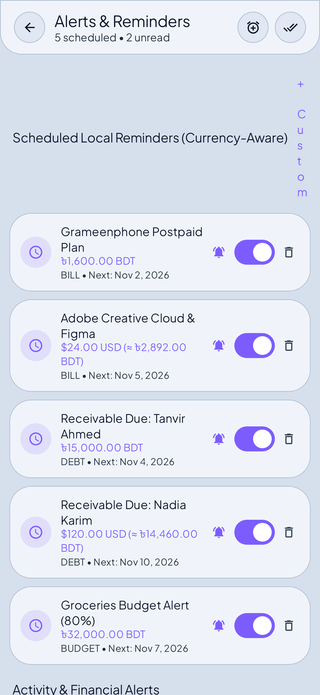
  <br><em>Bills and reminders</em>
</p>
<p align="center">
  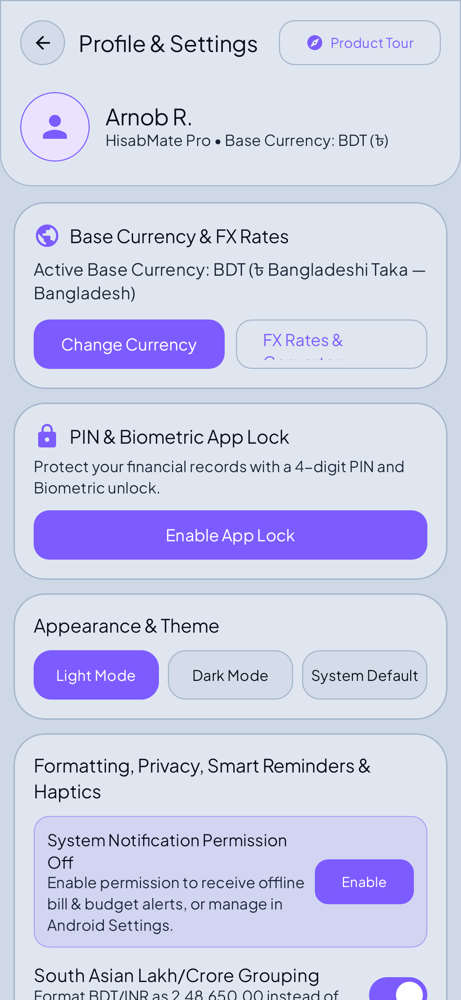
  <br><em>Settings and data management</em>
</p>
</details>

---

## Supported currencies

| Code | Currency | Symbol | Minor-unit precision |
|---|---|:---:|:---:|
| BDT | Bangladeshi Taka | ৳ | 2 |
| USD | US Dollar | $ | 2 |
| EUR | Euro | € | 2 |
| GBP | British Pound | £ | 2 |
| INR | Indian Rupee | ₹ | 2 |
| JPY | Japanese Yen | ¥ | 0 |
| CNY | Chinese Yuan | ¥ | 2 |
| SAR | Saudi Riyal | ر.س | 2 |
| AED | UAE Dirham | د.إ | 2 |
| CAD | Canadian Dollar | CA$ | 2 |
| AUD | Australian Dollar | A$ | 2 |
| SGD | Singapore Dollar | S$ | 2 |
| MYR | Malaysian Ringgit | RM | 2 |
| KWD | Kuwaiti Dinar | د.ك | 3 |

---

## Architecture

HisabMate uses a layered Android architecture with a repository boundary, a ViewModel-driven UI state and a local Room database.

```text
app/src/main/java/com/example/
├── data/
│   ├── local/
│   │   ├── Entities.kt
│   │   ├── HisabDao.kt
│   │   └── HisabDatabase.kt
│   └── repository/
│       └── HisabRepository.kt
├── ui/
│   ├── components/
│   ├── screens/
│   ├── theme/
│   └── viewmodel/
├── util/
└── MainActivity.kt
```

### Technology stack

| Area | Technology |
|---|---|
| Language | Kotlin 2.2.10 |
| UI | Jetpack Compose · Material 3 |
| Architecture | Repository pattern · ViewModel · StateFlow |
| Local database | Room 2.7 · SQLite schema v7 |
| Asynchronous work | Kotlin Coroutines |
| Dependency processing | KSP |
| Unit/UI testing | JUnit 4 · Robolectric |
| Android SDK | Compile/Target API 36 · Minimum API 24 |
| Build tool | Gradle 9.3.1 |

---

## Privacy and permissions

HisabMate does not declare the Android `INTERNET` permission in its application manifest. Its finance records are stored locally in the app's private storage; the app does not require a cloud account to manage those local records.

The manifest declares these permissions for specific device features:

| Permission | Purpose |
|---|---|
| `POST_NOTIFICATIONS` | Display local bill and budget reminders |
| `RECEIVE_BOOT_COMPLETED` | Restore scheduled reminders after device restart |
| `VIBRATE` | Haptic feedback |
| `CAMERA` | Camera-based app functionality; camera hardware is optional |

**Backup reminder:** local storage is not a substitute for a backup. Export a JSON backup before uninstalling the app, changing devices or performing maintenance that may clear app data.

---

## Build from source

### Requirements

- JDK 21
- Android SDK and Android SDK Platform 36
- Gradle 9.3.1
- Git

### Clone

```bash
git clone https://github.com/CodeByArnob/HisabMate.git
cd HisabMate
```

### Run tests and lint

```bash
gradle :app:testDebugUnitTest
gradle :app:lintDebug
```

### Build a debug APK

```bash
gradle :app:assembleDebug
```

The debug APK is generated under:

```text
app/build/outputs/apk/debug/
```

### Build a release APK and AAB

Configure a release keystore and the corresponding environment variables in your local build environment. The release signing configuration expects the keystore alias `upload`.

**PowerShell:**

```powershell
$env:KEYSTORE_PATH = "C:\path\to\upload-keystore.jks"
$env:STORE_PASSWORD = "your-store-password"
$env:KEY_PASSWORD = "your-key-password"

gradle :app:assembleRelease :app:bundleRelease
```

**Linux / macOS:**

```bash
export KEYSTORE_PATH="/path/to/upload-keystore.jks"
export STORE_PASSWORD="your-store-password"
export KEY_PASSWORD="your-key-password"

gradle :app:assembleRelease :app:bundleRelease
```

Never commit keystores, signing passwords, API keys or other secrets to the repository.

---

## Continuous integration

The Android CI workflow runs the automated test suite, Android Lint and build verification for debug and release packages.

- [Android CI workflow](https://github.com/CodeByArnob/HisabMate/actions/workflows/android-ci.yml)
- [Latest successful v1.0.6 release build](https://github.com/CodeByArnob/HisabMate/actions/runs/41315740240)
- [All workflow runs](https://github.com/CodeByArnob/HisabMate/actions)

---

## Contributing

Contributions, bug reports and focused improvements are welcome.

1. Fork the repository.
2. Create a feature branch: `git checkout -b feat/your-change`.
3. Keep changes scoped and follow the existing Kotlin and Compose conventions.
4. Run tests and lint before opening a pull request.
5. Describe the problem, implementation and verification steps in your pull request.

For substantial changes, open an issue first to discuss the proposed approach.

---

## License

HisabMate is distributed under the [MIT License](LICENSE).

---

<div align="center">

**HisabMate** · Built for clarity, control and local-first personal finance.

[Download](https://github.com/CodeByArnob/HisabMate/releases/download/v1.0.6/HisabMate-v1.0.6-release.apk) · [Website](https://codebyarnob.github.io/HisabMate/) · [Report an issue](https://github.com/CodeByArnob/HisabMate/issues)

</div>
