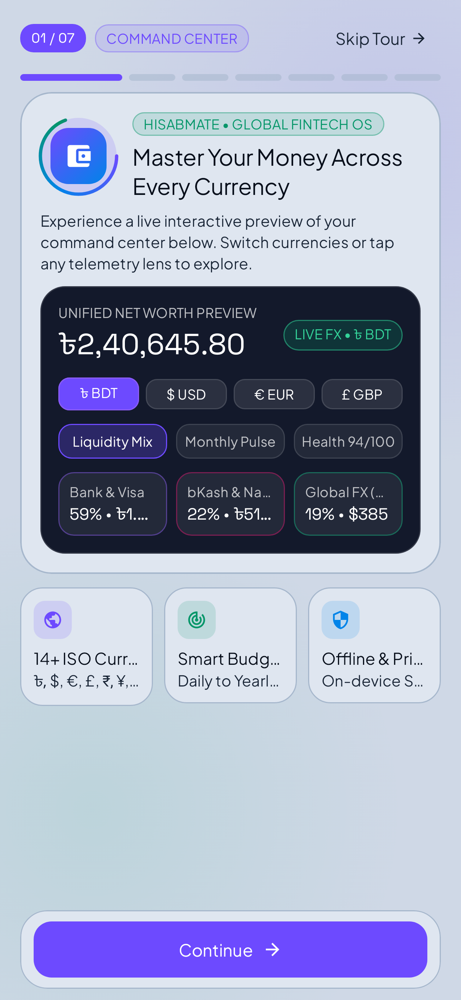
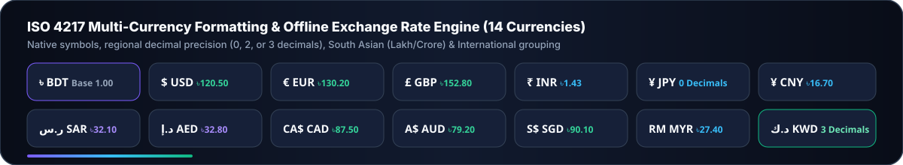
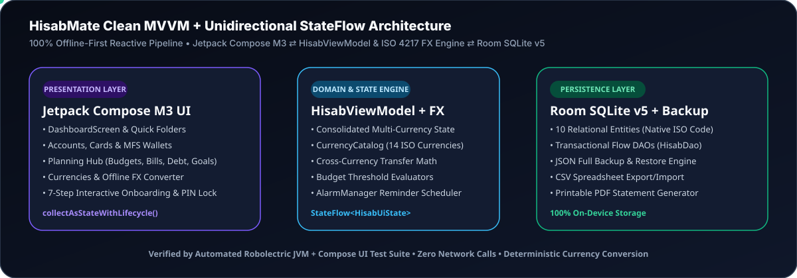

<div align="center">



<br />

# HisabMate – Smart Multi-Currency Personal Finance Manager

**A privacy-first, offline-native international personal finance, budgeting, multi-currency wallet, debt ledger, and wealth analytics application for Android.**

[](https://github.com/CodeByArnob/HisabMate/releases/tag/v1.0.0)
[-10B981?style=for-the-badge&logo=android)](https://github.com/CodeByArnob/HisabMate/releases/download/v1.0.0/HisabMate-v1.0.0-release.apk)
[](https://github.com/CodeByArnob/HisabMate/releases/download/v1.0.0/HisabMate-v1.0.0-release.aab)
[](https://github.com/CodeByArnob/HisabMate/actions/workflows/android-ci.yml)
[](https://codebyarnob.github.io/HisabMate/)
[](https://developer.android.com)
[](LICENSE)

[**Live Project Website**](https://codebyarnob.github.io/HisabMate/) • [**Download APK (`v1.0.0`)**](https://github.com/CodeByArnob/HisabMate/releases/download/v1.0.0/HisabMate-v1.0.0-release.apk) • [**Download AAB (`v1.0.0`)**](https://github.com/CodeByArnob/HisabMate/releases/download/v1.0.0/HisabMate-v1.0.0-release.aab) • [**Release Notes**](https://github.com/CodeByArnob/HisabMate/releases/tag/v1.0.0) • [**Screenshots**](#-application-screenshots--motion-walkthrough) • [**Architecture**](#-architecture--engineering)

</div>

---

## Direct Release Downloads (`v1.0.0`)

Compiled from verified source using Gradle `:app:assembleRelease` and `:app:bundleRelease`, validated with Android SDK `apksigner`, `aapt2`, Android Lint (`:app:lintDebug`), and Robolectric JVM/Compose UI tests (`:app:testDebugUnitTest`):

| Artifact | Format | Target / Purpose | Direct Download Link |
| :--- | :---: | :--- | :--- |
| **`HisabMate-v1.0.0-release.apk`** | `.apk` (`~11.1 MB`) | Direct installation on Android 7.0 – 16 (`API 24–36`) devices | [**Download APK**](https://github.com/CodeByArnob/HisabMate/releases/download/v1.0.0/HisabMate-v1.0.0-release.apk) |
| **`HisabMate-v1.0.0-release.aab`** | `.aab` (`~10.8 MB`) | Android App Bundle for Play Console / `bundletool` distribution | [**Download AAB**](https://github.com/CodeByArnob/HisabMate/releases/download/v1.0.0/HisabMate-v1.0.0-release.aab) |
| **`SHA256SUMS.txt`** | `.txt` | SHA-256 cryptographic checksums for release verification | [**Download SHA256SUMS.txt**](https://github.com/CodeByArnob/HisabMate/releases/download/v1.0.0/SHA256SUMS.txt) |

- **Application ID**: `com.aistudio.hisabmate.fntkbd`
- **Version**: `1.0.0` (`versionCode = 1`)
- **Supported Android Versions**: Android 7.0 Nougat (`minSdk = 24`) through Android 16 (`targetSdk = 36`, `compileSdk = 36`)
- **APK SHA-256**: `98ce4769ec00433434db9ae0fbfc43a70cbbdc819571b929d840f6c469065d63`
- **AAB SHA-256**: `f73dc84502e20887569eafc60015569b59886ae765583df9768ed6daf6df3147`

---

## Overview

**HisabMate** (`com.aistudio.hisabmate.fntkbd`) is a modern Android personal finance application engineered with **Kotlin**, **Jetpack Compose (Material 3)**, and **Room SQLite v5**. Designed for global professionals, freelancers, travelers, and households managing money across multiple currencies and payment rails (bank cards, mobile financial services like **bKash**, **Nagad**, **Rocket**, international **Wise / Revolut** accounts, and cash wallets), HisabMate combines institutional-grade financial clarity with **100% offline-first privacy**.

Every monetary record is stored in its **authentic native ISO 4217 currency** alongside a snapshot exchange rate, while dashboard net worth, category budgets, and cashflow reports dynamically consolidate into your chosen base currency.

---

## Application Screenshots & Motion Walkthrough

All screenshots below are rendered directly from the running HisabMate Jetpack Compose UI via Robolectric Native Graphics (`@GraphicsMode(NATIVE)`).

### Light Mode, Dark Mode & Animated Walkthrough Reel

| **Home Dashboard (Light Mode)** | **Home Dashboard (Dark Mode)** | **Animated 10-Screen Walkthrough** |
| :---: | :---: | :---: |
|  |  |  |
| *Soft Slate-Cool canvas (`#E6ECF5`) with elevated `#FFFFFF` cards* | *Obsidian surface hierarchy (`#0A0D14` / `#131824`) for zero eye strain* | *Automated walkthrough across core Compose screens* |

### Core Financial Flows & Modules

| **Multi-Currency & Offline FX Converter** | **Accounts, Cards & MFS Wallets** | **Category Wallet & Daily Spend Curve** |
| :---: | :---: | :---: |
|  |  |  |

| **Budget Management & Thresholds** | **Spend Analysis & Cashflow Reports** | **Savings Goals & Milestone Pots** |
| :---: | :---: | :---: |
|  |  |  |

| **Debt & Loan Ledger** | **Scheduled Reminders & Alerts** | **Security, Backup & Settings** |
| :---: | :---: | :---: |
|  |  |  |

| **Interactive 7-Step Onboarding Experience** |
| :---: |
|  |

---

## Key Features

### 1. Authentic Multi-Currency Architecture & Offline FX Engine
- **14 Built-in ISO 4217 Currencies**: Native symbols, regional decimal precision (`0` decimals for `JPY`, `2` for `BDT`/`USD`/`EUR`/`GBP`, `3` for `KWD`), and optional South Asian (`1,25,000`) vs. International (`125,000`) digit grouping.
- **Per-Entity Native Currency Persistence**: Accounts, transactions, budgets, recurring bills, savings goals, debt records, and scheduled notifications each preserve their own native `currencyCode`.
- **Interactive Offline FX Converter & Custom Rates**: Convert between any supported currency pair offline and override exchange rates manually in the **Currencies & FX Rates** manager.

### 2. Multi-Rail Account & Wallet Management
- Track **Bank Accounts**, **Credit/Debit Cards**, **Mobile Financial Services (bKash, Nagad, Rocket)**, **Global Multi-Currency Accounts (Wise, Revolut)**, and **Cash Wallets**.
- Instant inter-account transfers with automatic cross-currency conversion when moving funds between accounts of different currencies.

### 3. Smart Transactions, Split Bills & Receipt OCR Simulation
- Record **Expenses**, **Income**, and **Transfers** with merchant metadata, notes, favorite templates, and split-expense breakdowns.
- Interactive **Wallet Details** view with daily spend line charts, month-over-month navigation, and quick category filtering.

### 4. Multi-Period Budgets & Proactive Threshold Alerts
- Configure category budgets across **Daily**, **Weekly**, **Monthly**, **Yearly**, or **Custom** date ranges in any ISO currency.
- Customizable alert thresholds (`50%`–`100%`) that automatically trigger local notifications when spending approaches or exceeds limits.

### 5. Planning Hub: Recurring Bills, Debt Ledger & Savings Goals
- **Recurring Payments**: Track subscriptions, rent, utilities, and recurring income with one-tap bill settlement.
- **Debt & Loan Ledger**: Separate tracking for **Money Lent (Receivables)** and **Money Borrowed (Payables)** with partial repayment history and progress bars.
- **Savings Goals**: Dedicated visual pots with target deadlines, milestone tracking (`25%`, `50%`, `75%`, `100%`), and instant contributions.

### 6. Currency-Aware Local Notifications & Scheduled Reminders
- Built on Android `NotificationCompat` and `AlarmManager` with 4 dedicated notification channels (`Bill Reminders`, `Budget Threshold Alerts`, `Debt & Loan Reminders`, `Savings Goal Milestones`).
- Automatically reschedules active reminders across device reboots and timezone changes via `ReminderBootAndTimeReceiver`.

### 7. Security, Offline Privacy & Data Portability
- **100% Offline-First**: Zero cloud lock-in, zero third-party analytics SDKs, and zero telemetry.
- **App Lock**: Optional 4-digit PIN lock overlay and biometric unlock flow.
- **Full Data Ownership**: Export and restore complete **JSON Backups**, export/import **CSV Spreadsheets**, and generate **PDF Financial Statements**.

---

## Supported Currencies (ISO 4217)

<div align="center">
  
</div>

<br />

| Code | Symbol | Currency Name | Region | Decimals | Grouping Support |
| :--- | :---: | :--- | :--- | :---: | :--- |
| **BDT** | `৳` | Bangladeshi Taka | Bangladesh | 2 | South Asian (`1,25,000.00`) & Standard |
| **USD** | `$` | US Dollar | United States & Global | 2 | International (`125,000.00`) |
| **EUR** | `€` | Euro | European Union | 2 | International |
| **GBP** | `£` | British Pound Sterling | United Kingdom | 2 | International |
| **INR** | `₹` | Indian Rupee | India | 2 | South Asian & Standard |
| **JPY** | `¥` | Japanese Yen | Japan | 0 | International (`¥15,800`) |
| **CNY** | `¥` | Chinese Yuan Renminbi | China | 2 | International |
| **SAR** | `ر.س` | Saudi Riyal | Saudi Arabia | 2 | International |
| **AED** | `د.إ` | UAE Dirham | United Arab Emirates | 2 | International |
| **CAD** | `CA$` | Canadian Dollar | Canada | 2 | International |
| **AUD** | `A$` | Australian Dollar | Australia | 2 | International |
| **SGD** | `S$` | Singapore Dollar | Singapore | 2 | International |
| **MYR** | `RM` | Malaysian Ringgit | Malaysia | 2 | International |
| **KWD** | `د.ك` | Kuwaiti Dinar | Kuwait | 3 | International (`3` decimals) |

---

## Architecture & Engineering

<div align="center">
  
</div>

<br />

HisabMate follows **Clean MVVM Architecture** with unidirectional data flow (`StateFlow`) and reactive Room SQLite persistence:

```text
com.example
├── MainActivity.kt                  # Edge-to-edge Activity host & root navigation state machine
├── data
│   ├── local
│   │   ├── Entities.kt              # 10 Room SQLite entities (Accounts, Transactions, Budgets, FX, etc.)
│   │   ├── HisabDao.kt              # Reactive Flow queries & transactional DAO operations
│   │   └── HisabDatabase.kt         # Room Database (v5) + realistic multi-currency seed generator
│   └── repository
│       └── HisabRepository.kt       # Single source of truth, FX conversion, JSON/CSV backup & restore
├── ui
│   ├── components
│   │   └── FintechComponents.kt     # Reusable M3 cards, interactive Canvas charts, dock & badges
│   ├── screens
│   │   ├── DashboardScreen.kt       # Balanced home dashboard, quick actions & wallet details
│   │   ├── AccountsAndMoreScreens.kt# Accounts, global search, notifications & settings/security
│   │   ├── PlanningHubScreen.kt     # Budgets, recurring bills, debt ledger & savings goals
│   │   ├── CurrencyManagementScreen.kt # Offline FX converter & ISO 4217 rate manager
│   │   ├── SpendAnalysisScreen.kt   # Multi-period analytics & cashflow bar charts
│   │   ├── TransactionModals.kt     # Add/edit transaction sheet, split bills & receipt OCR presets
│   │   ├── CalendarAndSecurityScreens.kt # Monthly calendar heatmap & PIN lock screen
│   │   └── CinematicOnboardingScreen.kt  # Interactive 7-step fintech onboarding flow
│   ├── theme
│   │   ├── Color.kt                 # Semantic Light/Dark surface, ink, border & category palettes
│   │   ├── Theme.kt                 # HisabTheme tokens & Material 3 ColorScheme provider
│   │   └── Type.kt                  # Space Grotesk, Plus Jakarta Sans & Inter typography hierarchy
│   └── viewmodel
│       └── HisabViewModel.kt        # Reactive UI state aggregation & multi-currency math
└── util
    ├── CurrencyFormatter.kt         # ISO 4217 catalog, regional formatting & cross-rate math
    ├── HisabNotificationManager.kt  # AlarmManager scheduler, notification channels & receivers
    └── HapticFeedbackHelper.kt      # Tactile feedback helper
```

---

## Android Permissions Explained

HisabMate adheres strictly to the principle of least privilege and operates 100% offline:

| Permission | Required? | Purpose |
| :--- | :---: | :--- |
| `android.permission.POST_NOTIFICATIONS` | Optional (Runtime on Android 13+) | Delivers local bill due alerts, budget threshold warnings, debt reminders, and savings milestone notifications. |
| `android.permission.RECEIVE_BOOT_COMPLETED` | Normal (Install-time) | Allows `ReminderBootAndTimeReceiver` to reschedule active local `AlarmManager` reminders after a device reboot. |
| `android.permission.VIBRATE` | Normal (Install-time) | Provides subtle haptic feedback on financial actions and notification alerts when enabled in Settings. |
| `android.permission.CAMERA` | Optional (`android:required="false"`) | Used only when capturing a physical receipt photo to attach to a transaction. |

> **Note**: HisabMate does **not** request `INTERNET` or broad external storage permissions. Photo attachments use the zero-permission Android Photo Picker (`ActivityResultContracts.PickVisualMedia`).

---

## Installation, Build & Release Signing Instructions

### Option 1: Direct APK Installation
Download [**`HisabMate-v1.0.0-release.apk`**](https://github.com/CodeByArnob/HisabMate/releases/download/v1.0.0/HisabMate-v1.0.0-release.apk) from the [v1.0.0 Release page](https://github.com/CodeByArnob/HisabMate/releases/tag/v1.0.0) and install it on any Android 7.0+ (`API 24+`) device.

### Option 2: Clone & Build Locally

1. **Clone the repository**
   ```bash
   git clone https://github.com/CodeByArnob/HisabMate.git
   cd HisabMate
   cp .env.example .env
   ```

2. **Run Robolectric Unit/UI Tests & Android Lint**
   ```bash
   gradle :app:testDebugUnitTest :app:lintDebug
   ```

3. **Build the Debug APK**
   ```bash
   gradle :app:assembleDebug
   ```

### Option 3: Secure Production Release Signing (`assembleRelease` & `bundleRelease`)

`app/build.gradle.kts` reads production signing credentials strictly from environment variables so private keys are never committed to git:

```bash
export KEYSTORE_PATH="/path/to/my-upload-key.jks"
export STORE_PASSWORD="your-keystore-password"
export KEY_PASSWORD="your-key-password"

gradle :app:assembleRelease :app:bundleRelease
```

#### Configuring GitHub Actions Encrypted Repository Secrets
The automated release workflow (`.github/workflows/release.yml`) supports full production signing via GitHub Actions encrypted secrets:
1. Generate or locate your upload keystore (`keyAlias = "upload"`):
   ```bash
   keytool -genkeypair -v -keystore my-upload-key.jks -storetype PKCS12 -alias upload -keyalg RSA -keysize 2048 -validity 10000
   ```
2. Base64-encode the keystore file:
   ```bash
   base64 -w 0 my-upload-key.jks
   ```
3. In GitHub, navigate to **Settings → Secrets and variables → Actions → New repository secret** and add:
   - `UPLOAD_KEYSTORE_BASE64`: Base64 string of `my-upload-key.jks`
   - `STORE_PASSWORD`: Your keystore password
   - `KEY_ALIAS`: `upload` (or your custom alias, which `.github/workflows/release.yml` automatically maps)
   - `KEY_PASSWORD`: Your key password

*(Note: When these 4 repository secrets are not yet configured in GitHub Settings, `.github/workflows/release.yml` clearly logs a notice in the GitHub Actions Job Summary and generates an ephemeral RSA-2048 release key in `RUNNER_TEMP` so `:app:assembleRelease` and `:app:bundleRelease` remain verified and produce installable APK/AAB artifacts without ever committing a keystore file.)*

---

## Release History

| Version | Date | Highlights | Artifacts |
| :--- | :--- | :--- | :--- |
| **`v1.0.0`** | 2026-10-31 | Initial production release featuring 14 ISO 4217 currencies, offline FX converter, Bank/MFS wallets, multi-period budgets, savings goals, debt ledger, local AlarmManager notifications, 7-step interactive onboarding, and Light/Dark themes. | [APK](https://github.com/CodeByArnob/HisabMate/releases/download/v1.0.0/HisabMate-v1.0.0-release.apk) • [AAB](https://github.com/CodeByArnob/HisabMate/releases/download/v1.0.0/HisabMate-v1.0.0-release.aab) • [SHA256SUMS](https://github.com/CodeByArnob/HisabMate/releases/download/v1.0.0/SHA256SUMS.txt) |

---

## License

Distributed under the **MIT License**. See [`LICENSE`](LICENSE) for full license text.

Copyright © 2026 [CodeByArnob (Gameofbtc)](https://github.com/CodeByArnob).
